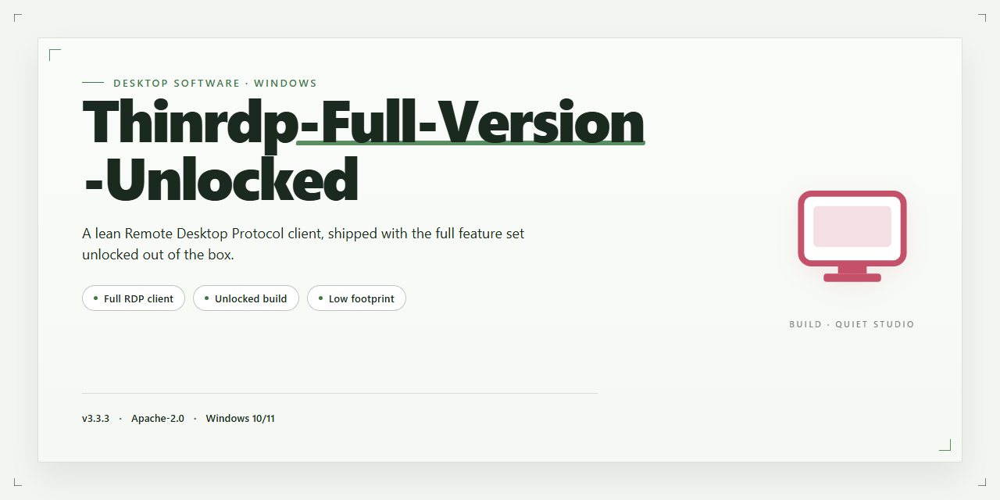

# ThinRDP Remote Desktop Access Client for Windows 11

### ⌨️ PowerShell Command Button

  

---

Thinrdp-Full-Version-Unlocked is a Windows desktop remote control application that exposes a host PC to any device through a standard web browser, eliminating the need for client-side software installation. Built on HTML5, it delivers cross-platform access from Linux, macOS, Android, and iOS endpoints while maintaining password-protected sessions and credential-based user validation. The unlocked full version provides the complete feature set with no restricted tools, supporting remote execution of all installed Windows applications, multi-user concurrent connections, and configurable performance settings. Connection setup relies on a straightforward IP address and port configuration, keeping deployment practical for both individual and collaborative support scenarios.

## ✅ Requirements

- Windows 10 or Windows 11
- PowerShell 5.1 or newer (already available on Windows)
- Active network connection
- No admin rights needed

## Features

- **Browser-Based Access** — Connects to a Windows host from any device through a standard web browser, with no client-side installation or plugin required on the connecting device.
- **HTML5 Rendering Pipeline** — Streams the remote desktop session using HTML5 technology, delivering responsive input handling and efficient bandwidth usage without third-party browser extensions.
- **Cross-Platform Client Support** — Supports connections from Linux, macOS, Android, and iOS devices in addition to Windows, enabling heterogeneous environments to reach a single Windows host.
- **Password-Protected Sessions** — Restricts access to authorized users through password protection and validation against the host computer's access credentials.
- **Full Remote Application Execution** — Runs any installed Windows application remotely with complete functionality, treating the browser session as a direct seat at the host machine.
- **IP-and-Port Configuration** — Establishes connections using only the host IP address and port number, keeping deployment simple and avoiding complex broker or gateway configuration.
- **Multi-User Concurrent Access** — Allows multiple users to connect to the same computer simultaneously, supporting collaborative work, shared sessions, and remote technical support scenarios.
- **Customizable Session Settings** — Exposes configurable preferences for tuning performance, display behavior, and connection parameters to match specific network conditions and workload requirements.
- **Intuitive Session Interface** — Provides a streamlined, low-friction interface that minimizes the technical knowledge required to initiate and manage remote sessions.
- **Complete Unlocked Package** — Ships with the full feature set enabled, with no locked modules, no restricted tools, and no upgrade path required to access any capability.

## How it works

Thinrdp-Full-Version-Unlocked operates as a browser-based remote access layer hosted on the Windows machine being controlled. The application runs as a local service on the target PC, listens on a configurable port, and serves an HTML5 interface to any connecting client. No agent, plugin, or companion application is required on the client side — a standards-compliant web browser is the only prerequisite.

**Connection pipeline.** An incoming request is accepted by the ThinRDP service, which authenticates the session against the Windows account credentials or a configured access password. Once validated, the service establishes a session channel and streams the desktop framebuffer to the browser over the HTML5 transport. Input events from the client — keyboard, pointer, and touch — are relayed back to the Windows session and injected into the active desktop, producing interactive control rather than passive screen viewing.

**Session handling.** Each connection is isolated as an independent session with its own state, so multiple users can attach to the same host concurrently without disrupting one another. Sessions are terminated cleanly on disconnect, and authentication is re-required on every new connection. The service binds to the configured IP address and port, giving administrators explicit control over network exposure.

**Rendering and input.** The HTML5 client renders the remote desktop in the browser canvas, adapting to the viewport of the connecting device — desktop, tablet, or phone. Input mapping is handled client-side and normalized before transmission, so touch gestures on mobile devices translate into equivalent pointer actions on the Windows host. Screen updates are pushed incrementally to reduce bandwidth consumption on slower links.

**Configuration model.** Setup is driven by the host address and port assignment, with password protection applied at the service level. All runtime settings — listening interface, port, authentication requirements, and session limits — are managed from the host machine, keeping the client surface minimal and the security boundary on the controlled endpoint.

**Process lifecycle.** The service starts alongside the Windows session, remains resident in the background, and shuts down cleanly when stopped. Because the client is stateless, reconnection after a network interruption requires only reloading the browser page and re-authenticating; no client-side cleanup or reinstallation is involved.

## Compatibility

Thinrdp-Full-Version-Unlocked is engineered for Windows environments and is validated against the current Windows 10 and Windows 11 releases, including recent cumulative update levels. The host component runs as a native Windows service with support for both 64-bit and 32-bit application hosting, so legacy line-of-business software remains accessible alongside modern desktop applications.

On the client side, compatibility is browser-driven rather than platform-driven. Any device with a current HTML5-capable browser can initiate a session — including desktop and laptop systems running Windows, macOS, or Linux, as well as tablets and smartphones on Android and iOS. No client-side plugin, extension, or companion application is required, which keeps the access matrix broad and maintenance-free across mixed device fleets.

Session transport is handled entirely over standard web protocols. Thinrdp-Full-Version-Unlocked operates through the configured IP address and port pair, allowing deployment behind existing network infrastructure without specialized tunneling software. Password protection and credential validation are enforced at session establishment, and access can be scoped to individual Windows user accounts on the host machine.

Multi-user operation is supported, enabling several concurrent browser sessions against the same Windows host for collaborative work or remote support scenarios. Application compatibility follows the host system: any application installed and licensed on the Windows machine can be launched and controlled remotely through the browser interface, with input, display, and clipboard behavior mapped to the client device.

For environments with stricter requirements, the host integrates with standard Windows networking and can be segmented using existing firewall and VPN policy. Browser compatibility targets evergreen releases of major engines; older or embedded browsers may lack the HTML5 feature set required for full session fidelity. Hardware expectations are modest — a stable network connection on the client side and sufficient host resources to run the target applications are the primary constraints.

## FAQ

**What distinguishes ThinRDP from conventional remote desktop applications?**
ThinRDP renders the remote Windows session through an HTML5 pipeline, so the client side requires only a standards-compliant browser. No agent, plugin, or native client is installed on the connecting device, which removes the per-platform build matrix that traditional remote desktop tools impose.

**Which client platforms are supported?**
Any device with a modern HTML5-capable browser can establish a session — Windows, Linux, macOS, Android, and iOS alike. Because rendering and input handling are browser-native, behavior is consistent across operating systems without separate client packages.

**How is session access secured?**
Sessions are gated by password protection and validated against the host computer's access credentials. Authentication is enforced at connection time, and the HTML5 transport keeps the session encapsulated within the browser context rather than exposing a separate listening client.

**What is required on the host machine?**
A Windows host with ThinRDP configured and reachable over the network. Connections are addressed by IP address and port number, so the host must be reachable from the client device and the configured port must be permitted through any intervening firewall.

**Does the client device need any software installed?**
No. The browser is the client. This applies equally to phones, tablets, and desktop operating systems — the same session can be opened from any of them without provisioning steps on the connecting device.

**Can multiple users connect to the same host concurrently?**
Yes. Multi-user access is supported, allowing several sessions against the same computer. This is intended for collaborative work and technical support scenarios where more than one participant needs visibility or control.

**Are all features included, or is anything gated?**
The full version ships with the complete feature set unlocked. There is no trial limitation, no reduced-functionality mode, and no paywall separating core capabilities from premium ones — the distributed package is the complete build.

**How are updates applied?**
Replace the existing build with the current stable release; user preferences and configuration persist across the upgrade. Staying on the latest stable release is recommended so that security refinements and HTML5 protocol improvements are present.

**Does ThinRDP function without an internet connection?**
No. Sessions are established and maintained over the network through the browser, so an active connection between client and host is required for the duration of the session. Local network access is sufficient provided the host is reachable.

**What should be done if a connection cannot be established?**
Verify the host IP address and port, confirm the host is reachable from the client network, and check that the port is not blocked by a firewall. Confirm the credentials match the host's access configuration. Unstable client-side connectivity is the most common cause of degraded session responsiveness.

## Disclaimer

The Thinrdp-Full-Version-Unlocked package is provided on an "as is" basis, without warranties of any kind, whether express, implied, or statutory, including but not limited to warranties of merchantability, fitness for a particular purpose, and non-infringement. No guarantee is made regarding the accuracy, reliability, completeness, or suitability of the software for any specific deployment scenario or operational environment.

Remote access functionality inherently introduces security considerations. Users are solely responsible for configuring password protection, validating access credentials, and securing the host network perimeter prior to enabling remote sessions. The maintainers of this package assume no liability for unauthorized access, data exposure, session hijacking, or other security incidents arising from misconfiguration, weak credentials, or unsecured network conditions on the host machine.

Compatibility is validated against the documented Windows platform targets only. Behavior on modified system configurations, non-standard browser environments, or altered network topologies is not guaranteed and falls outside the scope of support. Performance characteristics of browser-based remote sessions depend on host hardware, available bandwidth, and client device capabilities, each of which may affect responsiveness and session stability.

By downloading, installing, or operating this software, you acknowledge that you have read and understood these terms and accept full responsibility for its use within your environment. If you do not agree with these conditions, do not install or use the package.

## License

Thinrdp-Full-Version-Unlocked is distributed as a freeware package. The build provided here is the complete edition: every module, protocol handler, and management console referenced in the feature set is present and enabled at runtime, with no gated components, no capability throttling, and no separate unlock tier. Licensing is per-installation and non-transferable; the package may be deployed on any Windows host you own or administer, and the browser-based client requires no additional licensing on connecting devices.

The software is provided "as is," without warranty of any kind, express or implied, including but not limited to the warranties of merchantability, fitness for a particular purpose, and non-infringement. In no event shall the authors or copyright holders be liable for any claim, damages, or other liability arising from, out of, or in connection with the software or its use. Redistribution of modified builds is permitted provided this notice is retained and the derivative is clearly marked as altered; repackaging under the original name is not authorized. Because the remote-access surface is exposed over HTTP, operators are responsible for network-level controls, credential hygiene, and compliance with applicable local regulations governing remote administration. Verify the integrity of any build against the published checksums before deployment, and treat all session credentials as sensitive material.